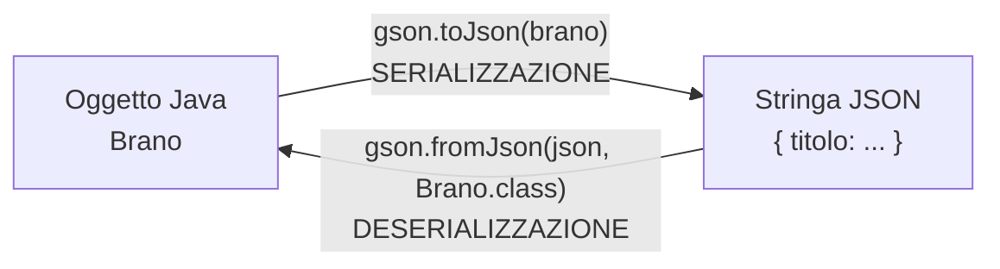

# 📖 00 — Esempio commentato: "Il brano del momento" (Spotify)

Quando apri un brano su **Spotify**, l'app chiede i dati al server, che risponde con un **testo in formato JSON**. L'app lo trasforma in un oggetto e ti mostra titolo, artista, durata…
In questo esempio facciamo la stessa cosa in piccolo, con la libreria **Gson**.

## ▶️ Esecuzione

```bash
cd 00-esempio-spotify
java -cp ../lib/gson-2.11.0.jar EsempioBrano.java
```

## 🔁 Il ciclo che vedrai



| Passo nel codice | Cosa succede | Concetto chiave |
|:-:|:--|:--|
| 1 | Creo un `Brano` con `new` | Classe modello = **POJO** |
| 2 | `Gson gson = new Gson();` | Il "traduttore", se ne crea uno e lo si riusa |
| 3 | `gson.toJson(brano)` | Ogni **campo** diventa una coppia `"chiave": valore` |
| 4 | `new GsonBuilder().setPrettyPrinting().create()` | JSON indentato, leggibile per gli umani |
| 5 | `gson.fromJson(testo, Brano.class)` | Dal testo all'oggetto: i campi si abbinano **per nome** |
| 6 | Uso getter e `if` | Dopo il parsing il JSON "non c'è più": ho un oggetto Java |
| 7 | JSON incompleto o con chiavi in più | Chiavi in più → **ignorate**; chiavi mancanti → valore di **default** (0, false, null) |

## 📏 Le 4 regole d'oro della classe modello

1. **Nome del campo = nome della chiave JSON** (maiuscole e minuscole contano!).
2. I campi possono essere `private`: Gson li legge comunque.
3. Serve un **costruttore vuoto** (Gson lo usa in `fromJson`).
4. Getter, setter e altri metodi servono **a te**, non a Gson: i metodi **non** finiscono nel JSON (vedi `getDurataFormattata()`).

## ❓ Domande di controllo

1. Che tipo Java restituisce `gson.toJson(...)`? Perché è importante per inviarlo in rete?
2. Perché il JSON "compatto" si usa per le macchine e quello indentato per le persone?
3. Se il server aggiunge al JSON la chiave `"genere"`, il programma va in errore?
4. Se il JSON non contiene `"durataSecondi"`, che valore avrà il campo? E se il campo fosse una `String`?

➡️ Ora passa all'[esercizio 01](../01-serie-tv/).
