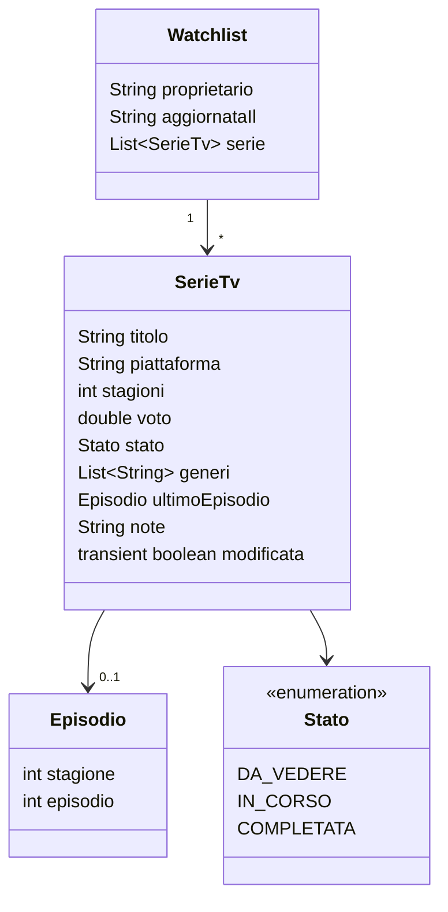

# ✏️ 02 — Esercizio guidato: "La mia Watchlist"

> **Evoluzione dell'esercizio 01**: non più una serie sola, ma l'intera lista di serie che stai guardando, salvata su **file**. Qui trovi **tutte le funzionalità essenziali** per padroneggiare il JSON in Java.

## 🎯 Obiettivi

| Funzionalità | Classe / costrutto Gson | Passo |
|:--|:--|:-:|
| Chiave JSON diversa dal campo Java (`snake_case` → `camelCase`) | `@SerializedName` | 1 |
| Escludere un campo dal JSON | `transient` | 1 |
| Leggere un file JSON | `fromJson(Reader, Classe.class)` | 2 |
| Oggetti annidati, array, enum, `null` | classi annidate, `List<String>`, `enum` | 3 |
| Scrivere un file JSON | `toJson(oggetto, Writer)` | 4 |
| Scrivere anche i valori `null` | `GsonBuilder().serializeNulls()` | 5 |
| JSON che inizia con `[` (lista come radice) | `TypeToken<List<X>>` | 6 |
| Oggetto JSON ↔ mappa | `Map<String, X>` + `TypeToken` | 7 |
| Leggere/costruire JSON **senza classi** | `JsonParser`, `JsonObject`, `JsonArray`, `toJsonTree` | 8 |
| Gestire gli errori | `JsonSyntaxException`, `IOException` | 2, 9 |

## 📝 Scenario
Giulia tiene la sua watchlist in un file [`watchlist.json`](./watchlist.json). Il tuo programma deve leggerla, mostrarla, aggiornarla e salvarla; poi usarla insieme a dati che arrivano da "fuori" (una classifica, i prezzi degli abbonamenti, la risposta di una API tipo TMDB).

```json
{
  "proprietario": "Giulia",
  "aggiornata_il": "2026-11-20",
  "serie": [
    {
      "titolo": "Mare Fuori",
      "piattaforma": "RaiPlay",
      "stagioni": 5,
      "voto": 8.5,
      "stato": "IN_CORSO",
      "generi": ["Drammatico", "Crime"],
      "ultimo_episodio": { "stagione": 4, "episodio": 6 },
      "note": null
    }
  ]
}
```



## ▶️ Esecuzione

```bash
cd 02-watchlist
java -cp ../lib/gson-2.11.0.jar WatchlistApp.java
```

Il file [`WatchlistApp.java`](./WatchlistApp.java) compila già. Esegui il programma **dopo ogni passo**.

## 🪜 Passi

**Passo 0 — Gson leggibile.** Completa la costante `GSON_BELLO` con il pretty printing.

**Passo 1 — Modello dati.** Le classi in fondo al file sono quasi complete, ma **mancano alcune cose volutamente**. Completa i `TODO 1.x`:
* `Episodio.avanza()` e `Episodio.toString()` (→ `"S4E6"`);
* `@SerializedName("ultimo_episodio")` e `@SerializedName("aggiornata_il")`;
* `transient` sul campo `modificata`;
* `Watchlist.cerca(titolo)`.

> [!TIP]
> Prova a eseguire il programma **prima** di aggiungere le annotazioni (dopo aver fatto il passo 2): vedrai `aggiornata il null` e nessun episodio. Questo è il tipico bug di chi lavora con API reali!

**Passo 2 — Lettura da file.** Completa `caricaWatchlist()` con `Files.newBufferedReader(...)` in un *try-with-resources* e `GSON.fromJson(reader, Watchlist.class)`. Gestisci `IOException` (file mancante) e `JsonSyntaxException` (file rovinato).

**Passo 3 — Navigazione.** Stampa ogni serie su una riga (titolo, piattaforma, stato, ultimo episodio o `-`, generi uniti con `String.join`), la nota solo se presente, poi voto medio e numero di serie `IN_CORSO`.

**Passo 4 — Modifica e salvataggio.** Aggiungi *One Piece*, fai avanzare *Mare Fuori* di un episodio, aggiorna la data, completa `salvaWatchlist()` e apri `watchlist_aggiornata.json`: c'è il campo `modificata`? La chiave è `ultimo_episodio`?

**Passo 5 — `null`.** Stampa *One Piece* con `GSON` e con un Gson creato con `serializeNulls()`: cosa cambia?

**Passo 6 — Liste come radice.** Leggi la "top 3" (un array JSON) prima con `List.class` (che classe hanno gli elementi?) e poi con `new TypeToken<List<SerieTv>>(){}.getType()`.

**Passo 7 — Map.** Conta le serie per piattaforma in una `Map<String,Integer>` e serializzala; poi leggi i prezzi degli abbonamenti in una `Map<String,Double>` e calcola la spesa mensile.

**Passo 8 — Tree model.** Dalla risposta della API estrai `total_results` e, per ogni risultato, `name`, `vote_average` (se manca → `n.d.`, usa `has()`) e il primo `origin_country`. Poi costruisci un JSON "a mano" con `JsonObject`/`JsonArray` e infine modifica un POJO trasformato in albero con `toJsonTree()`.

**Passo 9 — Errori.** Prova i 3 JSON "difettosi" con `try/catch`. Attenzione: per i `double` Gson può lanciare `NumberFormatException`.

### ✅ Output atteso (estratto)

```text
=== PASSO 3 - Contenuto della watchlist ===
  Stranger Things  Netflix  COMPLETATA ultimo: S5E8    generi: Fantascienza, Horror, Avventura
      nota: Il finale mi ha distrutta
  Mare Fuori       RaiPlay  IN_CORSO   ultimo: S4E6    generi: Drammatico, Crime
  ...
  Voto medio: 8.75  |  Serie in corso: 2

=== PASSO 6 - Array come radice (TypeToken) ===
  Con List.class gli elementi sono: LinkedTreeMap
  Con TypeToken gli elementi sono: SerieTv

=== PASSO 9 - Errori ===
  ERR  {"titolo":"Dark","voto":"altissimo"}  -> NumberFormatException
  OK   {"titolo":"Dark","stato":"ABBANDONATA"}  -> stato=null
  ERR  {"titolo":"Dark", "voto": 9.0  -> JsonSyntaxException
```

## 🤔 Quando usare cosa?

| Situazione | Strumento consigliato |
|:--|:--|
| Conosco bene la struttura e la uso tutta | **POJO** + `fromJson` / `toJson` |
| La struttura è enorme/variabile e mi servono pochi campi | **Tree model** (`JsonParser`, `JsonObject`) |
| Le chiavi sono "dati" (nomi di piattaforme, giorni, utenti…) | **`Map<String, X>`** |
| La radice è un array o uso tipi generici | **`TypeToken`** |

## ❓ Domande di verifica
1. Perché `fromJson(json, List.class)` non basta per ottenere una `List<SerieTv>`?
2. Che differenza c'è tra un campo `transient` e un campo con valore `null`?
3. Un enum con un valore sconosciuto (`"ABBANDONATA"`) genera un errore? Che rischio comporta?
4. Perché è importante specificare `StandardCharsets.UTF_8` quando si leggono e scrivono file JSON?

## 🚀 Sfide extra (facoltative)
* Aggiungi un menu testuale: *1) mostra 2) aggiungi serie 3) segna episodio visto 4) salva ed esci*.
* Ordina le serie per voto prima di salvarle.
* *(Avanzato)* Trasforma `aggiornataIl` in `LocalDate` scrivendo un `TypeAdapter` registrato con `GsonBuilder().registerTypeAdapter(...)`.

➡️ Ora sei pronto per l'[esercizio 03](../03-quiz-socket/): il JSON viaggia in rete!
