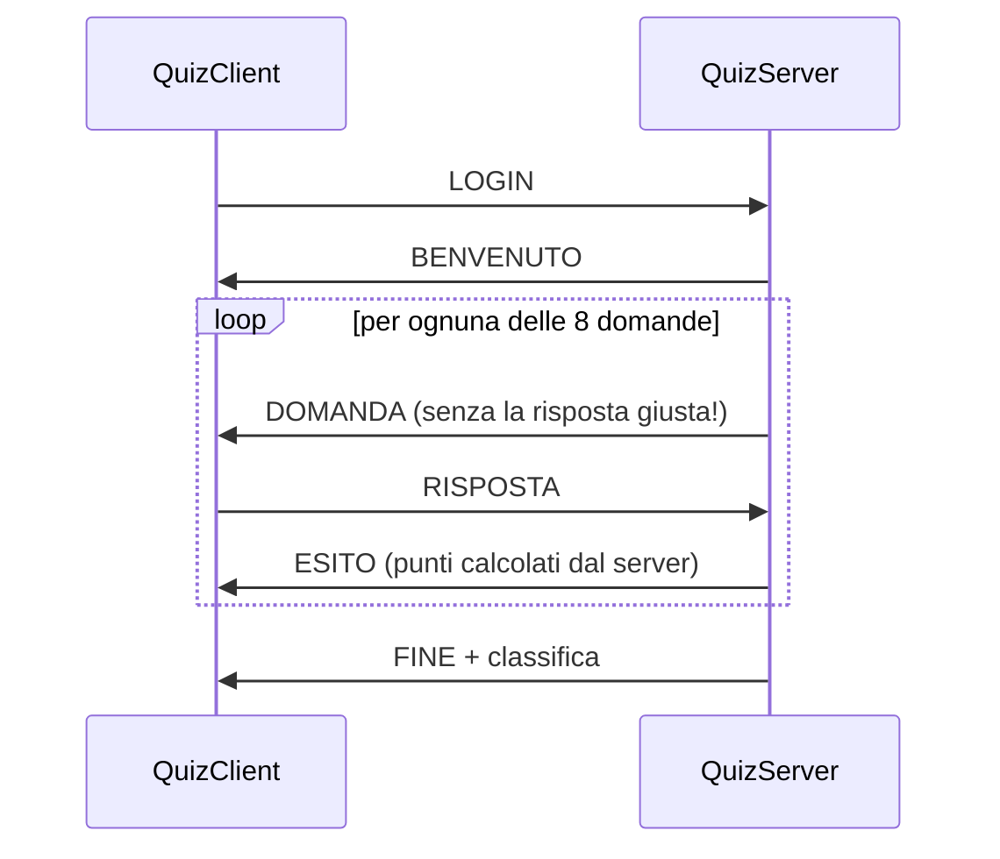

# ✏️ 03 — Esercizio guidato: "QuizBattle" (stile Kahoot) con socket TCP

> Ora il JSON **viaggia in rete**: client e server si scambiano messaggi JSON su un socket TCP. È lo stesso principio di Kahoot, dei giochi online e delle chat: il JSON diventa il **protocollo applicativo**.

## 🎯 Obiettivi
* Usare il JSON come **formato dei messaggi** tra due programmi diversi.
* Definire e rispettare un **protocollo** (tabella dei messaggi con campo `"tipo"`).
* Smistare i messaggi ricevuti: `JsonParser` → leggo `"tipo"` → `fromJson` nella classe giusta.
* Gestire più giocatori in contemporanea (un **thread** per client) e i messaggi non validi.

## 🕹️ Come funziona il gioco
1. Ogni studente avvia il **client** e si collega al **server** (quello del prof o il proprio).
2. Il server invia 8 domande (musica, calcio, videogiochi, anime, reti…).
3. Più rispondi in fretta, più punti fai: **1000** se rispondi subito, **500** allo scadere dei 20 secondi, **0** se sbagli.
4. Alla fine ricevi la **classifica** di tutti i giocatori.

## 📡 Il protocollo

* Trasporto: **TCP**, porta predefinita **5050**, testo **UTF-8**.
* **Un messaggio JSON per riga** (terminato da `\n`): per questo si usa il JSON **compatto** (un JSON indentato conterrebbe degli "a capo" e verrebbe spezzato!).
* Ogni messaggio contiene il campo **`"tipo"`**, che dice come interpretare il resto.
* Gli indici delle risposte sono **0-based** (come gli array): l'utente digita 1-4, il client invia 0-3.

| Direzione | `tipo` | Esempio |
|:-:|:--|:--|
| C → S | `LOGIN` | `{"tipo":"LOGIN","nickname":"Sara"}` |
| S → C | `BENVENUTO` | `{"tipo":"BENVENUTO","nickname":"Sara","numeroDomande":8,"tempoSecondi":20,"messaggio":"Ciao Sara! ..."}` |
| S → C | `DOMANDA` | `{"tipo":"DOMANDA","numero":1,"totale":8,"categoria":"Musica","testo":"Chi ha vinto il Festival di Sanremo 2024?","opzioni":["Geolier","Annalisa","Angelina Mango","Mahmood"],"tempoSecondi":20}` |
| C → S | `RISPOSTA` | `{"tipo":"RISPOSTA","numero":1,"scelta":2}` |
| S → C | `ESITO` | `{"tipo":"ESITO","numero":1,"corretta":true,"inTempo":true,"rispostaGiusta":2,"punti":940,"punteggioTotale":940,"tempoMs":2400,"spiegazione":"Angelina Mango con \"La noia\"."}` |
| S → C | `FINE` | `{"tipo":"FINE","punteggioTotale":6994,"classifica":[{"nickname":"Sara","punti":6994},{"nickname":"Marco","punti":4993}]}` |
| S → C | `ERRORE` | `{"tipo":"ERRORE","messaggio":"JSON non valido: ciao"}` |



> [!IMPORTANT]
> **Sicurezza e protocollo.** Il server legge le domande da [`domande.json`](./domande.json) nella classe `Domanda`, che contiene la risposta giusta (`"corretta"`). Al client però invia un `MsgDomanda`, che **non** ha quel campo: se lo mandasse, chiunque potrebbe barare leggendo il JSON! Per lo stesso motivo il **tempo di risposta lo misura il server**, non il client.

> [!NOTE]
> Client e server **non condividono le classi Java**: sono due programmi diversi, ognuno con le sue classi `Msg...`. Il vero "contratto" è il **formato JSON** della tabella: potresti riscrivere il client in Python o JavaScript e funzionerebbe lo stesso.

## ▶️ Esecuzione

Servono **due terminali** (o più, uno per ogni giocatore), entrambi nella cartella `03-quiz-socket`:

```bash
# Terminale 1 - server
java -cp ../lib/gson-2.11.0.jar QuizServer.java

# Terminale 2, 3, ... - client (host e porta facoltativi)
java -cp ../lib/gson-2.11.0.jar QuizClient.java localhost 5050
```

Per provare il client prima di aver completato il server, collegati al **server avviato dal docente** sul suo PC in laboratorio (indicando il suo indirizzo IP al posto di `localhost`).

## 🪜 Parte A — Il client ([`QuizClient.java`](./QuizClient.java))

| TODO | Cosa fare | Classi / metodi |
|:-:|:--|:--|
| **A1** | Costruisci e invia il `LOGIN` senza scrivere una classe | `JsonObject`, `addProperty` |
| **A2** | Trasforma ogni riga ricevuta in `JsonObject` e leggi `"tipo"` | `JsonParser.parseString(...).getAsJsonObject()` |
| **A3** | `DOMANDA`: converti in `MsgDomanda`, chiedi la risposta, invia `MsgRisposta` | `GSON.fromJson(jsonObject, Classe.class)` |
| **A4** | `ESITO`: converti in `MsgEsito` e stampa giusta/sbagliata/tempo scaduto | `fromJson` |
| **A5** | `FINE`: converti in `MsgFine` e stampa la classifica numerata | `fromJson` con lista annidata |
| **A6** | Completa le classi `MsgEsito`, `VoceClassifica`, `MsgFine` guardando la tabella | POJO |

> [!TIP]
> Lascia `MOSTRA_JSON = true`: il client stampa tra `[<- ...]` e `[-> ...]` il **JSON grezzo** che viaggia sul socket. È il modo migliore per capire (e per fare debug).

## 🪜 Parte B — Il server ([`QuizServer.java`](./QuizServer.java))

Socket, thread e lettura delle righe sono già pronti. Tu completi le parti "JSON":

| TODO | Cosa fare | Classi / metodi |
|:-:|:--|:--|
| **B1** | Carica `domande.json` (un **array**) in una `List<Domanda>` | `Files.newBufferedReader`, `TypeToken` |
| **B2** | Converti la risposta in `MsgRisposta`, calcola esito e punti, invia `MsgEsito` | `fromJson(JsonObject, ...)` |
| **B3** | Completa `invia()`: serializza in JSON **compatto** e spedisci una riga | `toJson`, `println` |
| **B4** | Costruisci la classifica ordinata (diventerà un array JSON) | `List<VoceClassifica>`, `sort` |

Studia anche il codice già pronto:
* `leggiMessaggio()` — cosa succede se un client manda `ciao` o `[1,2]` invece di un oggetto JSON?
* `MsgBenvenuto`, `MsgDomanda`… — perché il campo `tipo` è `final` con un valore fisso?
* `new GsonBuilder().disableHtmlEscaping()` — prova a toglierlo: come diventa l'apostrofo di `"piu' sei veloce"`? (Gson di default scrive `\u0027` per sicurezza nelle pagine HTML: è JSON valido, ma meno leggibile.)

## 🎉 Gioco in classe
Il docente avvia il server di soluzione sul proprio PC e comunica l'**indirizzo IP** (es. `192.168.1.10`). Ogni studente si collega con il **proprio** client:

```bash
java -cp ../lib/gson-2.11.0.jar QuizClient.java 192.168.1.10
```

Il terminale del server mostra in tempo reale tutti i JSON scambiati: proiettatelo alla LIM!

## 🔍 Test "da hacker" (consigliato)
Prova a parlare con il server **a mano**, come farebbe un client scritto male o malevolo:

```bash
# Linux/macOS (nc) - su Windows si puo' usare telnet o PuTTY in modalita' Raw
nc localhost 5050
ciao
{"nickname":"x"}
{"tipo":"LOGIN","nickname":"Hacker"}
{"tipo":"RISPOSTA","numero":1,"scelta":2}
```

Il server deve rispondere con messaggi `ERRORE` senza mai andare in crash.

## ❓ Domande di verifica
1. Perché si usa un JSON per riga e non un JSON indentato?
2. Perché il client prima legge il messaggio come `JsonObject` e solo dopo usa `fromJson`?
3. Cosa succederebbe se il server inviasse direttamente gli oggetti `Domanda`?
4. Perché la mappa `classifica` del server è una `ConcurrentHashMap`?
5. Il server è in Java: si potrebbe scrivere il client in un altro linguaggio? Cosa dovrebbe rispettare?

## 🚀 Sfide extra (facoltative)
* Aggiungi al protocollo il messaggio `{"tipo":"CLASSIFICA"}` con cui un client chiede la classifica in qualsiasi momento.
* Aggiungi nuove domande a `domande.json` (senza toccare il codice!) su argomenti scelti dalla classe.
* Fai in modo che il server mescoli le domande e ne invii solo 5 a caso.
* *(Avanzato)* Partita sincronizzata: il server aspetta che si colleghino N giocatori e poi invia le domande a tutti contemporaneamente.
