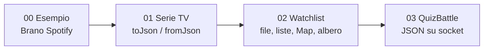

# ☕ JSON in Java con Gson — Percorso di esercizi introduttivi

Percorso pratico per le classi **quinte (TPSIT)**: dall'idea di base di JSON fino a un quiz multigiocatore in rete, stile **Kahoot**, con **socket TCP**.
Gli argomenti degli esercizi (Spotify, serie TV, quiz su musica, calcio, videogiochi, anime) sono scelti apposta per essere **vicini ai ragazzi di 17-18 anni**.

| # | Cartella | Tipo | Argomento | Cosa si impara | Tempo indicativo |
|:-:|:--|:--|:--|:--|:-:|
| 00 | [`00-esempio-spotify`](./00-esempio-spotify/) | 📖 Esempio commentato | Il brano del momento (Spotify) | Ciclo completo `toJson` / `fromJson`, POJO, `GsonBuilder` | 20 min |
| 01 | [`01-serie-tv`](./01-serie-tv/) | ✏️ Esercizio guidato | La mia serie TV preferita | Variante dell'esempio: classi e costrutti essenziali | 45 min |
| 02 | [`02-watchlist`](./02-watchlist/) | ✏️ Esercizio guidato | La mia Watchlist | **Tutte le funzioni essenziali**: file, annidamento, liste, enum, `null`, `@SerializedName`, `transient`, `TypeToken`, `Map`, tree model, errori | 90 min |
| 03 | [`03-quiz-socket`](./03-quiz-socket/) | ✏️ Esercizio guidato + gioco in classe | QuizBattle (stile Kahoot) | JSON come **protocollo applicativo** su socket TCP, client/server multi-thread | 90-135 min |
| — | Google Drive (accesso riservato) | 🔒 Per il docente | — | Soluzioni complete e risposte di verifica | — |



---

## ⚙️ Requisiti e avvio (zero configurazione)

* **Java 17 o superiore** (si usano i *text block* `"""` e lo `switch` con `->`).
* La libreria **Gson 2.11.0** è già inclusa in [`lib/gson-2.11.0.jar`](./lib/): **non serve Internet né Maven**.
* Ogni programma è **un solo file `.java`**: Java 11+ lo esegue direttamente, senza `javac`.

Da dentro la cartella dell'esercizio (Windows, Linux e macOS):

```bash
java -cp ../lib/gson-2.11.0.jar NomeFile.java
```

> [!TIP]
> Se usate un IDE (IntelliJ, NetBeans, VS Code, Eclipse) aggiungete `lib/gson-2.11.0.jar` alle librerie del progetto, oppure con Maven/Gradle:
>
> ```xml
> <dependency>
>   <groupId>com.google.code.gson</groupId>
>   <artifactId>gson</artifactId>
>   <version>2.11.0</version>
> </dependency>
> ```

---

## 🗺️ Mappa JSON ↔ Java (da tenere sotto mano)

| JSON | Esempio JSON | Java |
|:--|:--|:--|
| stringa | `"Netflix"` | `String` |
| numero intero | `5` | `int`, `long` |
| numero decimale | `8.5` | `double` |
| booleano | `true` / `false` | `boolean` |
| `null` | `null` | `null` (solo per tipi oggetto: `String`, classi, liste…) |
| oggetto | `{ "stagione": 4, "episodio": 6 }` | una **classe** (POJO) oppure `Map<String, …>` oppure `JsonObject` |
| array | `["Horror", "Sci-Fi"]` | `List<…>` (o array Java) oppure `JsonArray` |
| stringa "fissa" | `"IN_CORSO"` | `enum` |

## 🧰 Le classi Gson usate nel percorso

| Classe / costrutto | A cosa serve (spiegazione e uso pratico) | Esercizio |
|:--|:--|:-:|
| `Gson` | Motore principale Java ↔ JSON (thread-safe e riutilizzabile): `toJson(obj)` serializza un oggetto in stringa JSON compatta; `fromJson(json, Classe.class)` deserializza la stringa in un'istanza tipizzata abbinando chiavi e campi per nome. | 00, 01 |
| `GsonBuilder` | Fabbrica configurabile (`new GsonBuilder()...create()`): `setPrettyPrinting()` indenta il JSON per gli umani; `serializeNulls()` scrive esplicitamente anche i campi `null`; `disableHtmlEscaping()` evita codici Unicode come `\u0027` per gli apostrofi. | 00–03 |
| `JsonSyntaxException` / `JsonParseException` | Eccezioni lanciate se il JSON è sintatticamente rotto (es. parentesi mancante) o ha tipi incompatibili (es. testo al posto di un `int`). Per i `double` Gson può lanciare `NumberFormatException`: meglio catturarle entrambe. | 01–03 |
| `@SerializedName("chiave_json")` | Annotazione su un campo Java per mappare una chiave JSON con nome diverso (es. `"ultimo_episodio"` in `snake_case` → `ultimoEpisodio` in `camelCase`). | 02 |
| `transient` | Modificatore Java che esclude del tutto un campo dalla serializzazione e deserializzazione (ideale per flag interni, cache o dati sensibili). | 02 |
| `fromJson(Reader…)` / `toJson(obj, Writer)` | Lettura e scrittura diretta su file/stream con `Files.newBufferedReader/Writer` in UTF-8 (dentro *try-with-resources*) senza caricare tutto in una `String`. | 02, 03 |
| `TypeToken<List<X>>` | Supera la *type erasure* dei generics per deserializzare array JSON radice `[ ... ]` in `List<X>` o oggetti in `Map<String, V>` (altrimenti `List.class` produrrebbe mappe generiche `LinkedTreeMap`). | 02, 03 |
| `JsonParser`, `JsonObject`, `JsonArray`, `JsonElement` | **Tree model**: legge, naviga (`has()`, `get()`) e costruisce JSON **senza creare classi POJO**. Utile per API esterne enormi e per protocolli su socket (leggere prima `"tipo"` e poi smistare). | 02, 03 |
| `toJsonTree(obj)` | Ponte POJO → Tree model: trasforma un oggetto Java in un `JsonObject` modificabile in RAM per aggiungere o rimuovere proprietà al volo prima di inviarlo/salvarlo. | 02 |

---

## 👩‍🏫 Note per il docente

* Le **soluzioni** sono conservate esclusivamente nella cartella **Google Drive con permessi ristretti al docente** (non nel repository pubblico GitHub).
* I file di partenza degli esercizi **compilano ed eseguono già** così come sono: lo studente vede subito un output e completa i `TODO` passo dopo passo.
* Nell'esercizio 02 il modello dati contiene **"bug" voluti** (annotazioni mancanti): lo studente scopre da solo perché alcuni campi risultano `null`.
* Nell'esercizio 03 potete avviare la soluzione del **server sul PC docente** e far giocare tutta la classe con i propri client: è il momento più coinvolgente del percorso.
