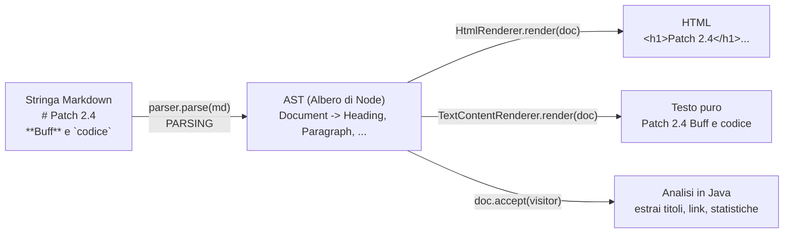

# 📖 00 — Esempio commentato: "Annuncio & Patch Notes" (stile Discord)

Quando scrivi `**GG!** Guarda la [patch](https://...)` su **Discord** o leggi un `README.md` su **GitHub**, il testo che scrivi è **Markdown**. L'app non mostra gli asterischi: usa un **parser** per trasformare il Markdown in un albero di nodi (**AST**) e poi un **renderer** per trasformarlo in HTML (o in testo semplice per le notifiche).
In questo esempio facciamo esattamente la stessa cosa in Java, con la libreria **commonmark-java**.

## ▶️ Esecuzione

```bash
cd 00-esempio-discord
java -cp "../lib/*" EsempioDiscord.java
```

Al termine viene creato anche `anteprima_discord.html`: aprilo con un doppio clic nel browser!

## 🔁 Il ciclo che vedrai



| Passo nel codice | Cosa succede | Concetto chiave |
|:-:|:--|:--|
| 1 | Scrivo una stringa Markdown (text block `"""`) | Il Markdown è **testo semplice** leggibile anche "grezzo" |
| 2 | `Parser.builder().build()` → `parser.parse(md)` | **Parsing**: il testo diventa un **AST** (`Node`) |
| 3 | `HtmlRenderer.builder().build().render(doc)` | **Rendering HTML**: pronto per browser o pagine web |
| 4 | `TextContentRenderer.builder().build().render(doc)` | **Testo puro**: toglie `#`, `**`, link (per notifiche push / preview) |
| 5 | `doc.accept(new AbstractVisitor() { ... })` | **Visitor**: naviga l'AST per estrarre titoli, link, codice… |
| 6 | `.escapeHtml(true).sanitizeUrls(true)` | **Sicurezza XSS**: neutralizza `<script>` e `javascript:` |
| 7 | `Files.writeString(Path.of("anteprima_discord.html"), ...)` | Salvo una pagina HTML completa da aprire nel browser |

## 📏 Le 4 regole d'oro di CommonMark in Java

1. **Parser e Renderer si creano una volta e si riusano** (sono *thread-safe*, come `Gson`).
2. **Prima si fa il parsing (`Node`), poi si lavora sull'albero**: sullo stesso `Node` puoi lanciare HTML, testo puro e `Visitor` senza ri-analizzare la stringa.
3. **Mai fidarsi del Markdown scritto dagli utenti**: in web/chat abilita sempre `escapeHtml(true)` e `sanitizeUrls(true)`.
4. **CommonMark core ≠ GitHub Flavored Markdown**: tabelle, `~~barrato~~` e checklist sono **estensioni** opzionali (le vedrai nell'esercizio 02!).

## ❓ Domande di controllo

1. Perché è utile avere un albero sintattico (**AST**) intermedio invece di convertire subito il Markdown in HTML con dei `replace(...)`?
2. A cosa serve `TextContentRenderer` in un'app reale come Discord o WhatsApp?
3. Cosa succede se un utente scrive `<script>alert('hack')</script>` in un messaggio Markdown e il server NON usa `escapeHtml(true)`?
4. Nel Passo 5, perché dentro `visit(Heading heading)` chiamiamo anche `visitChildren(heading)`?

➡️ Ora passa all'[esercizio 01](../01-scheda-gioco/).
