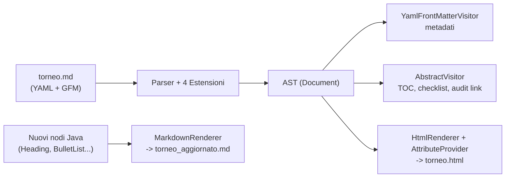

# ✏️ 02 — Esercizio guidato: "Portale del Torneo Esports di Classe"

> **Evoluzione dell'esercizio 01**: non più una singola stringa, ma un vero **mini generatore di siti statici** (stile GitHub Pages / Hugo / Obsidian Publish) che legge un file `.md`, usa le estensioni **GitHub Flavored Markdown**, genera un indice automatico, personalizza l'HTML e crea nuovo Markdown da codice Java. Qui trovi **tutte le funzionalità essenziali** per padroneggiare il Markdown in Java.

## 🎯 Obiettivi

| Funzionalità | Classe / costrutto CommonMark | Passo |
|:--|:--|:-:|
| Attivare estensioni GFM e YAML | `TablesExtension`, `StrikethroughExtension`, `TaskListItemsExtension`, `YamlFrontMatterExtension` | 1 |
| Leggere un file `.md` in UTF-8 | `Files.readString(Path, StandardCharsets.UTF_8)` | 2 |
| Estrarre metadati YAML Front Matter | `YamlFrontMatterVisitor` → `Map<String, List<String>>` | 3 |
| Generare un Indice (**TOC**) automatico | `AbstractVisitor` su `Heading` + creazione slug | 4 |
| Contare progressi checklist & audit link | `TaskListItemMarker.isChecked()`, `Link`, `FencedCodeBlock` | 5 |
| Personalizzare tag HTML (`id`, `target`, `class`) | `AttributeProvider`, `AttributeProviderFactory` | 6 |
| Salvare una pagina HTML sicura e completa | `HtmlRenderer` (`.escapeHtml(true)`, `.sanitizeUrls(true)`) | 6 |
| Costruire un AST in Java e salvarlo in `.md` | `Heading`, `Paragraph`, `BulletList`, `MarkdownRenderer` | 7 |

## 📝 Scenario
Il comitato gaming della 5ª gestisce le informazioni del torneo d'istituto nel file [`torneo.md`](./torneo.md). Il file contiene metadati YAML in testa, una tabella con la classifica, testo barrato (`~~LagInfinito~~`), una checklist delle attività (`- [x]` / `- [ ]`), un blocco di codice e alcuni link.
Il tuo programma deve:
1. leggere e analizzare il file;
2. estrarre i metadati e calcolare lo stato della checklist;
3. generare una pagina web `torneo.html` con **indice cliccabile**, link esterni con `target="_blank"` e tabelle stilizzate;
4. aggiungere in fondo una nuova sezione **"Aggiornamento Finale"** costruendola come **AST in Java** e salvandola in `torneo_aggiornato.md` con `MarkdownRenderer`!



## ▶️ Esecuzione

```bash
cd 02-diario-torneo
java -cp "../lib/*" TorneoSiteApp.java
```

Il file [`TorneoSiteApp.java`](./TorneoSiteApp.java) compila già. Esegui il programma **dopo ogni passo**.

## 🪜 Passi

**Passo 1 — Estensioni e Parser.** Crea la lista `estensioni` con le 4 estensioni (`TablesExtension`, `StrikethroughExtension`, `TaskListItemsExtension`, `YamlFrontMatterExtension`) e costruisci il `Parser` con `.extensions(estensioni)`.

**Passo 2 — Lettura del file.** Completa `caricaMarkdown()` leggendo `torneo.md` in UTF-8 e gestendo `IOException` se il file non esiste.

**Passo 3 — YAML Front Matter.** Esegui `YamlFrontMatterVisitor` sull'AST e stampa `titolo`, `autore`, `data` e la lista `tag` dalla mappa `visitor.getData()`.

**Passo 4 — Indice automatico (TOC).** Con un `AbstractVisitor` su `Heading`, costruisci la lista dei titoli (con livello e slug generato da `creaSlug(...)`) e stampa l'indice indentato in console.

**Passo 5 — Checklist e Audit.** Con un `AbstractVisitor`:
* conta quanti `TaskListItemMarker` hanno `isChecked() == true` e quanti `false`, calcolando la percentuale di completamento;
* raccogli tutti i `Link` e segnala con `[ATTENZIONE]` quelli che non iniziano con `https://`;
* raccogli i linguaggi dei `FencedCodeBlock`.

**Passo 6 — HTML personalizzato con `AttributeProvider`.** Configura `HtmlRenderer` con:
* `.extensions(estensioni)`, `.escapeHtml(true)`, `.sanitizeUrls(true)`;
* `.attributeProviderFactory(...)` che aggiunge:
  * `id="<slug>"` su ogni `Heading` (così i link dell'indice funzionano davvero!);
  * `target="_blank"` e `rel="noopener noreferrer"` su ogni `Link` che inizia con `http`;
  * `class="tabella-torneo"` su ogni `TableBlock`.
Salva il risultato in `torneo.html` e aprilo nel browser!

**Passo 7 — Java → AST → Markdown (`MarkdownRenderer`).** Costruisci in Java un piccolo `Document` con:
* un `Heading` di livello 2 (`"Aggiornamento Finale"`),
* un `Paragraph` con testo e `StrongEmphasis` (`"NullPointer"`),
* una `BulletList` con 2 `ListItem` (uno contenente un `Link`).
Trasformalo in stringa Markdown con `MarkdownRenderer.builder().extensions(estensioni).build()` e salva `torneo_aggiornato.md`.

### ✅ Output atteso (estratto)

```text
=== PASSO 3 - Metadati YAML Front Matter ===
  Titolo : Torneo Esports 5ª Informatica 2026
  Autore : Comitato Gaming 5A
  Data   : 2026-11-28
  Tag    : [esports, valorant, rocket-league, torneo]

=== PASSO 4 - Indice automatico (TOC) ===
  - Torneo Esports 5ª Informatica (#torneo-esports-5-informatica)
    - Classifica Provvisoria (#classifica-provvisoria)
    - Checklist Organizzazione (#checklist-organizzazione)
    - Configurazione Server Locale (#configurazione-server-locale)
    - Link Utili (#link-utili)

=== PASSO 5 - Checklist & Audit ===
  Attivita' completate: 3/5 (60%)
  Link trovati: 3
    [OK]         https://github.com/Amarte81
    [OK]         https://challonge.com
    [ATTENZIONE] http://esempio-vecchio.local/iscrizione  (non HTTPS!)
  Blocchi codice: [bash]
```

## ❓ Domande di verifica
1. Cosa succede se togli `TablesExtension` dal `Parser` ma lasci la tabella in `torneo.md`?
2. Perché i metadati YAML in testa a `torneo.md` non compaiono dentro `torneo.html`?
3. A cosa serve `rel="noopener noreferrer"` quando si aggiunge `target="_blank"` a un link HTML?
4. In che modo costruire un AST e usare `MarkdownRenderer` è più sicuro/pulito rispetto a concatenare stringhe con `+`?

## 🚀 Sfide extra (facoltative)
* Aggiungi al generatore di `torneo.html` un calcolo del **tempo stimato di lettura** (es. `parole / 200` minuti) usando `TextContentRenderer`.
* Scrivi un `AbstractVisitor` che conta quante righe (`TableRow`) ha la classifica nella tabella GFM.

➡️ Ora sei pronto per l'[esercizio 03](../03-chat-markdown-socket/): il Markdown viaggia in rete con i socket!
