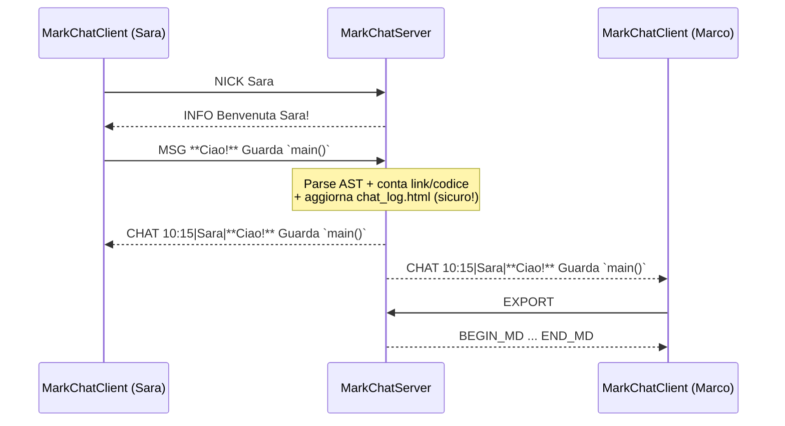

# ✏️ 03 — Esercizio guidato: "MarkChat" (stile Discord) con socket TCP

> Ora il Markdown **viaggia in rete**: più studenti si collegano con il proprio client a un server TCP, si scrivono messaggi formattati in **Markdown** (`**grassetto**`, `*corsivo*`, `` `codice` ``, `~~barrato~~`, `[link](url)`) e possono esportare la chat in HTML sicuro. È lo stesso principio di **Discord**, **Slack** e **Mattermost**!

## 🎯 Obiettivi
* Usare il Markdown come **formato dei messaggi** su una connessione **socket TCP**.
* Gestire più utenti contemporaneamente (server **multi-thread** + client con thread di ascolto).
* Formattare i messaggi Markdown nel terminale del client con un `AbstractVisitor` (codici ANSI).
* **Sanitizzare** lato server ogni messaggio (`escapeHtml(true)`, `sanitizeUrls(true)`) per generare una pagina live `chat_log.html` sicura da XSS.
* Esportare la trascrizione completa della chat via socket (`/export` → `.md` + `.html`).

## 📡 Il protocollo

* Trasporto: **TCP**, porta predefinita **5055**, testo **UTF-8**.
* **Un comando per riga** (terminato da `\n`):

| Direzione | Comando | Esempio | Significato |
|:-:|:--|:--|:--|
| C → S | `NICK <nome>` | `NICK Sara` | Entra in chat con il proprio nickname |
| C → S | `MSG <markdown>` | `MSG **GG!** Guarda [qui](https://github.com)` | Invia un messaggio Markdown |
| C → S | `STATS` | `STATS` | Richiede statistiche della chat (messaggi, link, codici) |
| C → S | `EXPORT` | `EXPORT` | Richiede la trascrizione completa in Markdown |
| C → S | `QUIT` | `QUIT` | Esce dalla chat |
| S → C | `INFO <testo>` | `INFO Benvenuta Sara! Utenti online: 2` | Avviso di sistema |
| S → C | `CHAT <ora>\|<nick>\|<md>` | `CHAT 10:15\|Sara\|**GG!**` | Messaggio in broadcast a tutti |
| S → C | `BEGIN_MD` … `END_MD` | *(righe Markdown)* | Blocco trascrizione esportata |
| S → C | `ERR <motivo>` | `ERR Devi prima fare NICK <nome>` | Errore gestito senza crash |



> [!IMPORTANT]
> **Sicurezza XSS in chat.** Quando il server scrive `chat_log.html` (che chiunque apre nel browser), **deve** usare `.escapeHtml(true)` e `.sanitizeUrls(true)`: altrimenti uno studente potrebbe scrivere `MSG <script>alert('hack')</script>` e far eseguire JavaScript nel browser del docente!

## ▶️ Esecuzione

Servono **due terminali** (o più, uno per ogni studente), entrambi nella cartella `03-chat-markdown-socket`:

```bash
# Terminale 1 - server
java -cp "../lib/*" MarkChatServer.java

# Terminale 2, 3, ... - client (host e porta facoltativi)
java -cp "../lib/*" MarkChatClient.java localhost 5055
```

Per sviluppare il client senza aver ancora finito il server, avvia il server di soluzione:

```bash
java -cp "../lib/*" ../soluzioni/03-chat-markdown-socket/MarkChatServer.java
```

### Comandi nel client
* Scrivi un qualsiasi messaggio in **Markdown** e premi Invio (es. `**Ciao** *ragazzi*, provate \`java -version\`!`).
* `/stats` — mostra quanti messaggi, link e snippet di codice sono stati inviati.
* `/export` — scarica la trascrizione della chat e la salva in `chat_esportata.md` e `chat_esportata.html`.
* `/quit` — disconnette il client.

## 🪜 Parte A — Il client ([`MarkChatClient.java`](./MarkChatClient.java))

Socket, lettura tastiera e thread di ascolto sono già pronti. Completa i `TODO A1..A4`:

| TODO | Cosa fare | Classi / metodi |
|:-:|:--|:--|
| **A1** | Configura `PARSER` (con `StrikethroughExtension`) e `HTML_SICURO` (`.escapeHtml(true)`, `.sanitizeUrls(true)`) | `Parser`, `HtmlRenderer` |
| **A2** | Completa `formattaPerTerminale(String md)`: fai il parsing e usa `AbstractVisitor` per formattare grassetto, corsivo, codice inline, barrato e link con codici ANSI | `AbstractVisitor`, `StrongEmphasis`, `Emphasis`, `Code`, `Link`, `Strikethrough` |
| **A3** | Gestisci l'input utente: `/stats` → `STATS`, `/export` → `EXPORT`, `/quit` → `QUIT`, altrimenti `MSG <riga>` | `PrintWriter.println` |
| **A4** | Completa `salvaEsportazione(String md)`: salva `chat_esportata.md` e genera `chat_esportata.html` con `HTML_SICURO` | `Files.writeString`, `HTML_SICURO.render(...)` |

## 🪜 Parte B — Il server ([`MarkChatServer.java`](./MarkChatServer.java))

`ServerSocket`, gestione thread e broadcast sono già pronti. Completa i `TODO B1..B4`:

| TODO | Cosa fare | Classi / metodi |
|:-:|:--|:--|
| **B1** | Configura `PARSER` e `HTML_SICURO` con le estensioni GFM (`TablesExtension`, `StrikethroughExtension`, `TaskListItemsExtension`) + sicurezza XSS | `Parser`, `HtmlRenderer`, `Extension` |
| **B2** | Completa `analizzaMessaggio(Node doc)`: usa un `AbstractVisitor` per incrementare i contatori `totaleLink` e `totaleCodici` | `AbstractVisitor`, `Link`, `Code`, `AtomicInteger` |
| **B3** | Completa `aggiornaChatHtml()`: trasforma ogni messaggio in HTML sicuro con `HTML_SICURO.render(...)` e scrivi `chat_log.html` | `HtmlRenderer`, `Files.writeString` |
| **B4** | Completa `costruisciTrascrizioneMd()`: costruisci la trascrizione Markdown della chat (`# Trascrizione MarkChat`, elenco dei messaggi) per il comando `EXPORT` | `StringBuilder` |

## 🎉 Chat in classe (alla LIM!)
1. Il docente avvia il server sul proprio PC e comunica l'**indirizzo IP** (es. `192.168.1.10`).
2. Il docente apre `chat_log.html` nel browser alla LIM (si aggiorna da solo ogni 3 secondi!).
3. Ogni studente si collega con il proprio client:
   ```bash
   java -cp "../lib/*" MarkChatClient.java 192.168.1.10 5055
   ```
4. Provate a mandare messaggi con `**grassetto**`, `~~barrato~~`, `` `codice` ``, `[link](https://...)`… e provate anche un attacco XSS `<script>alert('hack')</script>` per verificare che il server lo neutralizzi!

## 🔍 Test manuale con `nc` (netcat)
```bash
nc localhost 5055
MSG ciao senza nick
NICK Tester
MSG **Funziona** con `netcat`!
STATS
EXPORT
QUIT
```

## ❓ Domande di verifica
1. Perché nel protocollo il server invia ai client il **Markdown originale** (`CHAT ora|nick|md`) invece dell'HTML già pronto?
2. Perché in `MarkChatClient` serve un **secondo thread** per leggere i messaggi dal server?
3. Perché i contatori `totaleMessaggi`, `totaleLink` e `totaleCodici` sul server sono `AtomicInteger` invece di normali `int`?
4. Cosa succederebbe alla pagina `chat_log.html` se dimenticassi `.escapeHtml(true)` sul server?

## 🚀 Sfide extra (facoltative)
* Aggiungi il comando `/help` lato client che stampa un mini promemoria della sintassi Markdown supportata.
* Aggiungi sul server un filtro anti-link non HTTPS che avvisa l'utente con `INFO Attenzione: link non sicuro` se invia un URL `http://`.
* Salva automaticamente i messaggi anche su un file `cronologia.md` ad ogni nuovo messaggio così il server conserva la chat anche se viene riavviato.
