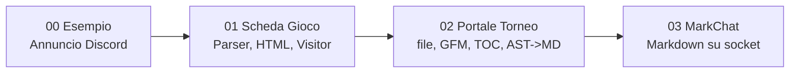

# ☕ Markdown in Java con CommonMark — Percorso di esercizi introduttivi

Percorso pratico per le classi **quinte (TPSIT)**: dall'idea di base di Markdown e del suo albero sintattico (**AST**) fino a una **chatroom stile Discord** in rete con **socket TCP**, formattazione live e anteprima HTML condivisa.
Gli argomenti degli esercizi (Discord, patch notes, schede di videogiochi, tornei esports di classe, chat in tempo reale) sono scelti apposta per essere **vicini ai ragazzi di 17-18 anni**.

| # | Cartella | Tipo | Argomento | Cosa si impara | Tempo indicativo |
|:-:|:--|:--|:--|:--|:-:|
| 00 | [`00-esempio-discord`](./00-esempio-discord/) | 📖 Esempio commentato | Annuncio & Patch Notes stile Discord | Ciclo completo `Parser` → AST (`Node`) → `HtmlRenderer` / `TextContentRenderer`, `AbstractVisitor`, sicurezza XSS | 20 min |
| 01 | [`01-scheda-gioco`](./01-scheda-gioco/) | ✏️ Esercizio guidato | La scheda del mio videogioco preferito | Variante dell'esempio: classi e costrutti essenziali di CommonMark in Java | 45 min |
| 02 | [`02-diario-torneo`](./02-diario-torneo/) | ✏️ Esercizio guidato | Portale del Torneo Esports di Classe | **Tutte le funzioni essenziali**: file `.md`, estensioni GFM (tabelle, barrato, checklist), YAML front matter, TOC automatico, `AttributeProvider`, costruzione AST → `MarkdownRenderer`, sicurezza | 90 min |
| 03 | [`03-chat-markdown-socket`](./03-chat-markdown-socket/) | ✏️ Esercizio guidato + chat in classe | MarkChat (stile Discord) | Markdown su **socket TCP**, client/server multi-thread, sanitizzazione XSS lato server, anteprima HTML live e `/export` | 90-135 min |
| — | [`soluzioni`](./soluzioni/) | 🔑 Per il docente | — | Soluzioni complete e testate | — |



---

## ⚙️ Requisiti e avvio (zero configurazione)

* **Java 17 o superiore** (si usano i *text block* `"""` e lo `switch` con `->`).
* La libreria **commonmark-java 0.24.0** (core + estensioni GFM e YAML front matter) è già inclusa in [`lib/`](./lib/): **non serve Internet né Maven**.
* Ogni programma è **un solo file `.java`**: Java 11+ lo esegue direttamente, senza `javac`.

Da dentro la cartella dell'esercizio (Linux, macOS e Windows — mantieni le virgolette attorno a `"../lib/*"`):

```bash
java -cp "../lib/*" NomeFile.java
```

> [!TIP]
> Se usate un IDE (IntelliJ, NetBeans, VS Code, Eclipse) aggiungete tutti i `.jar` di [`lib/`](./lib/) alle librerie del progetto, oppure con Maven/Gradle:
>
> ```xml
> <dependency>
>   <groupId>org.commonmark</groupId>
>   <artifactId>commonmark</artifactId>
>   <version>0.24.0</version>
> </dependency>
> <!-- Estensioni usate negli esercizi 02 e 03 -->
> <dependency>
>   <groupId>org.commonmark</groupId>
>   <artifactId>commonmark-ext-gfm-tables</artifactId>
>   <version>0.24.0</version>
> </dependency>
> <dependency>
>   <groupId>org.commonmark</groupId>
>   <artifactId>commonmark-ext-gfm-strikethrough</artifactId>
>   <version>0.24.0</version>
> </dependency>
> <dependency>
>   <groupId>org.commonmark</groupId>
>   <artifactId>commonmark-ext-task-list-items</artifactId>
>   <version>0.24.0</version>
> </dependency>
> <dependency>
>   <groupId>org.commonmark</groupId>
>   <artifactId>commonmark-ext-yaml-front-matter</artifactId>
>   <version>0.24.0</version>
> </dependency>
> ```

---

## 🗺️ Mappa Markdown ↔ AST Java ↔ HTML (da tenere sotto mano)

| Markdown | Esempio | Nodo AST (`org.commonmark.node.*`) | HTML generato |
|:--|:--|:--|:--|
| Titolo | `# Titolo` / `## Sottotitolo` | `Heading` (`getLevel()`) | `<h1>…</h1>`, `<h2>…</h2>` |
| Paragrafo | `Testo normale` | `Paragraph` | `<p>…</p>` |
| Grassetto | `**importante**` | `StrongEmphasis` | `<strong>…</strong>` |
| Corsivo | `*enfasi*` | `Emphasis` | `<em>…</em>` |
| Codice inline | `` `main()` `` | `Code` (`getLiteral()`) | `<code>…</code>` |
| Blocco codice | ```` ```java ... ``` ```` | `FencedCodeBlock` (`getInfo()`, `getLiteral()`) | `<pre><code class="language-java">…</code></pre>` |
| Link | `[GitHub](https://github.com)` | `Link` (`getDestination()`) | `<a href="…">…</a>` |
| Immagine | `` | `Image` (`getDestination()`) | `` |
| Lista puntata / numerata | `- voce` / `1. voce` | `BulletList` / `OrderedList` + `ListItem` | `<ul><li>…</li></ul>` |
| Citazione | `> frase` | `BlockQuote` | `<blockquote>…</blockquote>` |
| Tabella *(ext GFM)* | `\| Col \| Col \|` | `TableBlock`, `TableRow`, `TableCell` | `<table>…</table>` |
| Barrato *(ext GFM)* | `~~vecchio~~` | `Strikethrough` | `<del>…</del>` |
| Checklist *(ext GFM)* | `- [x] fatto` | `TaskListItemMarker` (`isChecked()`) | `<input type="checkbox" checked="" />` |
| Metadati *(ext YAML)* | `---\ntitolo: ...\n---` | `YamlFrontMatterBlock` / `YamlFrontMatterVisitor` | *(non stampato in HTML, letto in Java)* |

## 🧰 Le classi CommonMark usate nel percorso

| Classe / costrutto | A cosa serve | Esercizio |
|:--|:--|:-:|
| `Parser` (`Parser.builder().build()`) | Trasforma una stringa Markdown in un albero di nodi (**AST**) | 00, 01, 02, 03 |
| `Node` | Nodo generico dell'AST (il documento intero è un `Document`, sottoclasse di `Node`) | 00, 01, 02, 03 |
| `HtmlRenderer` | Trasforma l'AST in stringa **HTML** (`.escapeHtml(true)`, `.sanitizeUrls(true)`) | 00, 01, 02, 03 |
| `TextContentRenderer` | Estrae il **testo puro** senza simboli Markdown (ideale per notifiche/ricerche) | 00, 01, 02, 03 |
| `AbstractVisitor` | Visita l'AST intercettando nodi specifici (`Heading`, `Link`, `Code`, …) | 00, 01, 02, 03 |
| `Extension` (`TablesExtension`, `StrikethroughExtension`, `TaskListItemsExtension`, `YamlFrontMatterExtension`) | Attiva le estensioni GitHub Flavored Markdown e i metadati YAML | 02, 03 |
| `YamlFrontMatterVisitor` | Estrae i metadati (`Map<String, List<String>>`) dall'intestazione YAML | 02 |
| `AttributeProvider` / `AttributeProviderFactory` | Personalizza gli attributi HTML (es. `target="_blank"`, `id` per ancore, classi CSS) | 02 |
| `MarkdownRenderer` | Trasforma un AST (costruito o modificato in Java) **di nuovo in Markdown** | 02 |

---

## 👩‍🏫 Note per il docente

* Le **soluzioni** sono in [`soluzioni/`](./soluzioni/): ogni file indica in testa il comando esatto per eseguirlo.
* I file di partenza degli esercizi **compilano ed eseguono già** così come sono: lo studente vede subito un output e completa i `TODO` passo dopo passo.
* Negli esercizi 00, 01, 02 e 03 viene sempre richiamato il tema della **sicurezza (XSS e URL `javascript:`)**, fondamentale in TPSIT quando si renderizza Markdown proveniente da utenti esterni.
* Nell'esercizio 03 potete avviare la soluzione del **server sul PC docente**, aprire `chat_log.html` sul browser alla LIM e far collegare tutta la classe con il proprio `MarkChatClient`: i messaggi Markdown compaiono formattati in diretta!
